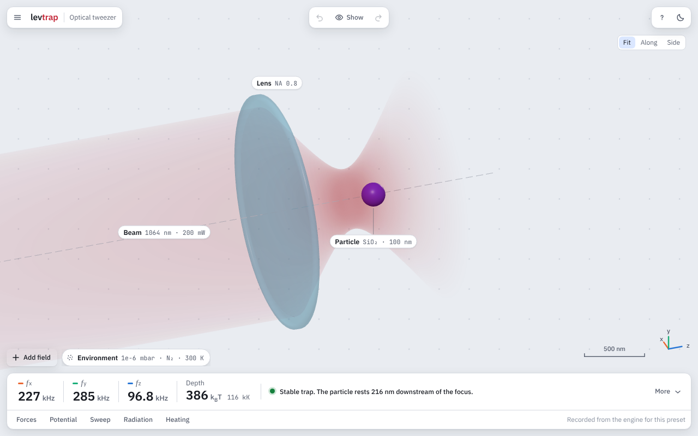

# levtrap: the screen

Status: **prototype for review** (issue #17, D1). The layout, the look and
the wording below are proposals until a human approves them. D2 to D6 build
on what is approved; section 12 lists the decisions that are open.

The prototype is clickable and runs on the real engine. Try it with
`npm run dev` (see the README), or look at the screenshots, in order and
with captions, in [`design/README.md`](design/README.md).

## 1. The idea

One screen. The trap is drawn; you click the thing you want to change; the
answer stays at the bottom and follows every change.

| Region | What it holds |
|---|---|
| **Scene** | The trap, drawn from the setup. Fills the screen. |
| **Islands** | Small groups of controls floating over the scene: file menu and name (top left), undo · show · redo (top centre), help and theme (top right), "Add field" and the environment (bottom left). |
| **Inspector** | The inputs of the selected thing. Shown only while something is selected. |
| **Results strip** | Three frequencies, the depth and the verdict. Always visible. |
| **Plots drawer** | One tab per plot, under the strip. Closed until a tab is clicked. |

The strip and the drawer form the **dock**. The dock sits under the scene and
never covers it: when the drawer opens, the scene gets shorter and is drawn
again to fit.

## 2. Vocabulary

The words of `docs/ARCHITECTURE.md` §2, used the same way everywhere (code,
labels, tests): **setup**, **particle**, **trap**, **field**, **beam**,
**environment**, **result**, **model**, **preset**.

The screen adds four:

| Term | Meaning | Avoid |
|---|---|---|
| **Part** | A thing that can be selected: the particle, a beam, a lens, a Paul trap, gravity, the environment. | object, element, component |
| **Lens** | The focusing optic of one beam. A part of its own, although the setup stores it inside the beam (`focus`). | objective, optic |
| **Label** | The pill beside a part with its name and its key values. | tag, chip |
| **Verdict** | The sentence in the strip that says whether the trap holds. | status, message |

## 3. The rules, and how the prototype keeps them

These are the rules of `docs/ARCHITECTURE.md` §7. Each has a test in
`tests/e2e/`.

| Rule | In the prototype |
|---|---|
| **Start from a preset, never from an empty form.** | A first visit opens the tweezer with its numbers on screen, and the preset picker over it. Every field added later arrives with working values. |
| **At most six inputs per selected thing.** | The largest inspector (the Paul trap) has six. Everything else is in one Advanced fold. Its summary names what differs from the default ("LG₀₁", "axial factor 0.3"), so a closed fold hides nothing that matters. |
| **The strip is always visible and always current.** | The strip is outside the scene, so nothing covers it. While a new result is computed the old numbers are dimmed, not removed. |
| **Every number explains itself.** | Click a number, in the strip or under More: its formula typeset (KaTeX, from the formula sheet `src/screen/formulas.ts`, with its source), the values that went in, the model and its validity, and a Copy button that copies the full SI value. A test typesets every formula. There is no glossary page. |
| **Fields take units as typed.** | `200 mW`, `0.2 W`, `1e-6 mbar`. Enter or leaving the field applies; Esc puts the old value back. The unit selector changes how the value reads, not the value. A mistake is answered with a sentence under the field. |
| **Warnings are sentences in the strip.** | "No stable trap along x and y: outside the first Mathieu stability region." followed by the usual cause and what to change. Each engine warning has a code and its copy in `src/screen/warnings.ts`; a test checks the engine still writes each one. No banners, no pop-ups. |
| **Plots are inline SVG in the theme's colours.** | The Forces tab. No Plotly. |
| **Undo and redo, light and dark.** | One step per edit; Ctrl Z and Ctrl Shift Z. Every edit is autosaved in the browser; a reload opens where you left off (a saved setup that no longer validates is not opened, and the screen says why). |
| **A setup travels as a file or a link.** | File menu: open and save a setup `.json` (the engine's own format, so `levtrap.solve` reads it), copy a share link (the setup lz-compressed in the fragment: no server, nothing sent), copy the Python that computes the same numbers, export the results (CSV: every number in SI with its model; JSON: the setup and the whole result; both carry the radiation pattern once the Radiation tab or the scene's pattern has computed it for this setup, #75) and the scene as PNG. Opening a file is an edit, so Ctrl Z takes it back. A link opens in place of the autosave and then leaves the address. Where the clipboard is refused (an embedded pane, an iframe), the link is shown under the scene in a read-only field, selected on focus, with a Copy button: a neutral notice that waits to be dismissed and never widens the screen (#74). The file and the link carry no float noise: a number is rounded to 12 significant digits when that moves it by no more than a few units in the last place, so 129.8 mW is written 0.1298, not 0.12980000000000003 (#81). |

Three more rules came out of building it:

* **Every number on screen comes from the engine.** A preset shows the
  result the engine recorded for it; anything else is computed. For a setup
  the engine cannot compute yet, the strip shows no numbers and says why,
  with the issue that will change it. Nothing is made up.
* **An invalid setup names the thing to fix.** "Particle: a Paul trap needs
  a charged particle…" with a "Show the particle" button that selects it.
* **Nothing is reachable by the mouse only.** Every part has a label that is
  a button; the drawing itself is decoration for a screen reader.

## 4. The scene

The scene is the trap in 3D (`src/screen/scene3d/`, react-three-fiber),
drawn from the setup, one drawable per kind of field. The flat SVG drawing
of the prototype stays for three jobs: the preset cards' thumbnails, the
moment while three.js loads, and browsers without WebGL (`?scene=svg` asks
for it).

* **Camera.** Orthographic, so a length across the view is drawn at the same
  scale wherever it is, and the scale bar is true everywhere in the picture.
  The scene is drawn in micrometres, so a 0.25 µm waist and a 3 mm
  electrode are both exact in one picture.
* **Views.** Fit (from above and a little upstream, the first beam running
  across), Along (looking down the first beam, or down a Paul trap's axis),
  Side (the beam left to right, y up). The buttons are top right. Drag
  turns the view, the wheel or a pinch zooms about the pointer, right-drag
  pans. The axes in the corner turn with the view.
* **Two scales.** A trap with light only fits the focus (micrometres); a
  trap with electrodes fits the electrodes (millimetres). The zoom crosses
  from one to the other without a step, and the scale bar follows: it is a
  round length (1, 2 or 5 × 10ⁿ) that is exactly as long as it says. When
  the view is far smaller than the electrodes, they are drawn faint, so the
  focus is not seen against a wall of metal.
* **To scale:** the particle at the computed equilibrium (in the tweezer
  216 nm downstream of the focus), the beam's waist and its cone angle (the
  hyperbola w(ζ) = √(w₀² + ζ² tan²θ)), the light's direction and focus, and
  the electrodes: a linear trap's rods are round, of radius 1.145 r₀ with
  their surfaces r₀ from the axis (the radius that best mimics hyperbolic
  electrodes), the RF pair on x; its end caps are rings at ±z₀, open so that
  light along z passes. A ring trap's ring has inner radius r₀; its end caps
  sit at ±z₀.
* **Not to scale:** the distance from an ideal lens to its focus (the lens
  is a symbol of the focusing optic, placed where the cone is 40 % of the
  view wide), and a particle that would be smaller than 4.5 px. Such a particle
  is drawn larger inside a dotted ring, and its label says "enlarged".
* **The scale toggle** (lower right, above the scale bar) says "Not to scale"
  while anything drawn is not (its tooltip lists what: the lens symbol, an
  enlarged particle, magnified motion). Pressed, it reads "To scale": the
  particle at its true size, the beam's waist and cone as they are (they
  always are), the motion not magnified, and the ideal lens's symbol left
  out (an ideal lens has only an NA, no size or distance): its cone runs on
  and its label waits at the edge of the view. A real lens and a mirror are
  always drawn to scale. Show → To scale is the same switch.
* **Motion** (the Play button, lower left; or the particle's inspector):
  the particle moves as the trap's modes oscillate, with a trail of the last
  ten periods of the slowest mode, fading with age. Each mode is a harmonic
  oscillator along its eigen-axis with the thermal variance k_BT/k at the
  gas temperature (equipartition); its two quadratures wander slowly
  (Ornstein–Uhlenbeck, twelve periods), so the path is a slowly changing
  Lissajous figure. Slowed down so the slowest mode takes 1.6 s (the fastest
  at most 6 Hz); frequency ratios kept. Not to scale, it is magnified by a
  round factor (1, 2 or 5 × 10ⁿ) to at least the drawn particle's radius; the
  note by the corner says the slow-down and the magnification
  (`src/screen/scene/motion.ts`). Disabled without a stable trap.
* **Radiation pattern** (Show menu, or the particle's inspector): the
  scattered power per solid angle as a surface about the particle, its
  distance from the centre in each direction proportional to I(θ, φ), the
  largest 80 px at the fitted scale (an angular plot: not to scale). From the
  engine (`want=["pattern"]`, the same grid as the Radiation tab), asked only
  while shown, and recomputed after every edit (`src/screen/scene/lobe.ts`).
* **A real lens** (the asphere, E1) is drawn from its prescription at its
  true size and distance (its back surface one back focal length before the
  aligned focus), tilted and decentred as set, and the light converges to
  where the ray trace puts the focus. Zoomed in on the focus it is out of
  view; its label then waits at the edge of the view, towards it.
* **Compare with the aligned lens** (lens inspector, #51): for a tilted or
  decentred asphere, a button solves the same setup with the lens aligned,
  starting from the particle's equilibrium so both describe the same trap
  (continuation, #50), and shows how far the particle moved (and along
  x, y, z) and each trap frequency against the aligned lens's. It updates
  with each edit while open; for an aligned lens the button is disabled.
* **A parabolic mirror** (E3) is drawn at its true size about the focus:
  the paraboloid between its hole and its rim, faint (a deep mirror stands
  all round the trap, which must stay in view through it), its rim and hole
  outlined; the outline carries the selection. The light is drawn as the
  cone of the beam's 1/e² edge on the mirror (at most 80°); the collimated
  input coming down around the focus is not drawn.
* **The light** is a volume: its brightness follows the intensity on the
  axis (1/w²), fades out past the focus, and fades upstream of the lens.
  Its colour is the wavelength's own when visible; infrared is the theme's
  laser red.
* **In the way.** A rod between the camera and the trap centre is drawn
  faint, and clicks pass through it.
* **Labels.** Every part has a label with its name and the values worth
  seeing without a click: "Beam 1064 nm · 200 mW", "Lens NA 0.8",
  "Particle SiO₂ · 100 nm". So the setup can be read off the drawing.
  A label and the drawn thing both select the part. A part turned or zoomed
  out of the view has no label. With labels hidden, hovering a thing names it.
  Labels that would cover each other (beams on one axis, their lenses) are
  staggered by a label's height (#81, `src/screen/scene/labels.ts`).
* **Selecting.** The selected part glows in the selection blue (the light:
  its edges) and its label turns blue. A ray through the scene meets several
  things: the particle wins over the lens and electrodes, which win over the
  light. Clicking the table deselects, and so does Esc; a drag never selects.
* **Overlays** (Show menu): the trap's eigen-axes through the equilibrium,
  and each field's force on the particle as an arrow (length on a log
  scale; only when more than one field shares the load, since with one the
  force at the equilibrium is zero).
* **Intensity slice** (Show menu, #48): the light's intensity, from the
  engine (`solve(…, want=["field"])`), on the lab plane through the trap
  that faces the camera: x–z or y–z from the side, x–y looking along a beam
  on z. It follows the view as the scene turns. It is drawn in the light's
  colour, opacity growing with the intensity, and while it is on it replaces
  the schematic light: interference (a standing wave's fringes) shows. A
  note by the scale bar names the plane and the peak intensity. It covers
  the box the force curves cover; the page asks for it only while it is
  shown.
* **Traced rays** (Show menu, #49): with a real lens (the asphere), two fans
  of rays traced through it (across x and across y, within the beam's 1/e²
  diameter), from the incoming beam, refracted at both surfaces, to the
  plane of its best focus; brighter where the beam is more intense. Zoomed
  out to millimetres they show the lens at work; the marginal rays miss the
  focus by its spherical aberration. Asked of the engine
  (`want=["lens"]`) only while shown.
* **Narrow screens.** There is no room for labels, so the parts become a row
  of buttons under the results. The row stays while a part is selected,
  between the results and its settings, so the next part is one tap away
  (#81).

## 5. The inspector: what each thing shows

"Visible" inputs are the ones a lab changes between one experiment and the
next. The reason each one is visible is in the last column.

**Particle**

| Input | Where | Why visible |
|---|---|---|
| Material | visible | It fixes n, k and density; most users know the material, not the index. The values it gives are shown under it. |
| Radius | visible | The quantity every frequency and rate depends on most strongly. |
| Charge | visible when the trap has a Paul field or the charge is not zero; otherwise Advanced | A Paul trap does nothing without it; a tweezer does not use it. |
| n, k, density | Advanced; editable when Material is Custom | They follow the material. |

**Beam**

| Input | Where | Why visible |
|---|---|---|
| Power | visible | The knob turned most often. |
| Wavelength | visible | A lab names its laser by wavelength and power. |
| Polarisation | visible | It is why f_x and f_y differ. It is in the beam's own frame (#71): on a beam not along beam 1 a note says so, and against beam 1 that Circular + turns the other way in the lab. |
| Direction | visible on a second beam | "Against beam 1" or "with beam 1": the difference between a counter-propagating trap and a superposition. Add field → Counter-propagating beam copies beam 1 but flips a circular polarisation (Circular + ↔ Circular −), so the two turn the same way in the lab and, once they interfere, make a standing wave (#71). |
| Interferes with | visible when there is another beam | Whether the forces add or the fields do (a standing wave). |
| Phase | visible when the beam interferes with another | Only then does it mean anything. Its note gives the reference: a factor e^iφ on the beam's field at its own focus, in its own frame (#71). |
| Darken the focus (a button) | visible on either beam of a coherent pair, once the result has the pair | A bottle beam (LG₀₀ + LG₁₀, the WS₂ preset) is dark only at one power split. The button sets the engine's split (`Result.coherent`, `levtrap.optics.dark_split`, #79) at the same total power: the two beams equally bright at the first beam's focus. Its sentence says the share it sets and whether the beams then cancel; when their phases or polarisations keep them from cancelling, it says how bright the focus stays. Greyed out when the split is already that one. Not offered for a group of three beams, or when one beam has no light at the focus. `src/screen/darken.ts`. |
| Coherent power | visible on each beam of a coherent group | The group's total power, the sum of its beams' powers (#97). A new total scales each beam's power and keeps their split, so a dark focus stays dark. A group with no power gets the total split evenly. `groupPower`, `withGroupPower` in `src/screen/plots/sweep.ts`. |
| Mode (Gaussian, LG, HG) and its indices; focus position x, y, z | Advanced | Most traps use a Gaussian beam focused at the origin. |

**Lens**

| Input | Where | Why visible |
|---|---|---|
| Type | visible | Ideal lens, the ray-traced asphere Thorlabs 354330-C (E1) or a parabolic mirror (E3); the last two are offered in a gas or vacuum, for a Gaussian beam. The part is then called Mirror. |
| Focal length, rim radius, beam diameter | visible: Mirror | They set the angles the light comes from (the rim's note says how far round, and whether the mirror is deep) and how much of the beam it catches. |
| Hole radius | Advanced: Mirror | Most mirrors have none or a small one; the note says which angles it removes. |
| NA and waist w₀ | visible, linked | Two descriptions of one focus: typing one updates the other (the waist through the mode's order). The setup keeps the one typed last. They set the trap's geometry, and with it every frequency. |
| Half-angle | Advanced, linked | The third description of the same focus. |
| Focus model, Filling | Advanced; Filling then visible in place of the waist | "Gaussian (OTT)" (the default: OTT's paraxial beam mapped by tan θ, as OTT-based papers use NA and waist), "Gaussian (sine)" (#64: mapped by sin θ as its angular spectrum is, with an aplanatic √cos θ; at small NA the textbook waist λ / (π NA), and a tighter focus than OTT's) or "Filled objective" (#61): an aplanatic objective of that NA whose back aperture the beam fills, the filling being the beam's 1/e² radius over the aperture's. Papers state an objective's NA, rarely how it was filled; the trap softens as the filling falls, most along the beam. |
| Aberration (#83) | Advanced, for a filled objective only: spherical, astigmatism 0° / 45°, coma x / y, each in waves rms, between −1 and 1; the fold's summary names the nonzero ones | A real objective's wavefront error over its pupil (Zernike). Spherical aberration softens the trap most along the beam: about 0.085 λ rms, just past the Maréchal limit 0.07, brings a 100× NA 0.9 objective to the measured frequency ratios (docs/validation/focus.md, #70). Kept through edits of the NA and the filling; dropped with another focus model. |

**Paul trap**

| Input | Where | Why visible |
|---|---|---|
| Geometry | visible | Linear or ring: two different traps. |
| RF voltage, RF frequency | visible | They set q, and so whether the trap is stable. |
| Radius r₀, half-length z₀ | visible | The size of the trap; q goes as 1/r₀². |
| End-cap voltage | visible for a linear trap | It makes the axial confinement. A ring trap does not use it. |
| DC voltage, geometry factors | Advanced | Zero and one for an ideal trap. |

**Particle: Show in the scene.** Under the particle's inputs, the things
drawn about it: the radiation pattern, the motion and the trap axes (the
same switches as the Show menu and the Play button), and a button that
opens the Radiation tab.

**Gravity:** Direction visible (down, along the beam, against the beam: how
the trap stands in the lab). The acceleration is Advanced.

**Environment:** Pressure, gas and temperature visible (they set the damping
and heating rates, and the depth in k_BT). The medium index is Advanced: it
is 1 in vacuum.

## 6. The results strip

| State | What the strip shows |
|---|---|
| Stable | Numbers, a green dot, "Stable trap." and where the particle rests. For a Paul trap also the largest Mathieu q. |
| Not stable | A red diamond, the reason along which axis ("No stable trap along z: …"), then the usual cause and what to change. An axis without a restoring force shows a dash. |
| Recomputing | The previous numbers, dimmed, and "Computing" on the right. |
| Engine starting | The same, with "Starting the engine 35%". A preset's numbers are on screen before the engine is ready. |
| Not computed yet | Dashes, an empty ring, the reason, and a link to the issue. |
| Invalid setup | Dashes, the reason in the engine's words, and a button that selects the part to fix. |
| Engine failed | The reason. |

Numbers have three significant figures and an SI prefix ("96.8 kHz").
Each frequency carries a short line in its axis colour; the text itself
stays in the text colour. The depth is in k_BT, with the same in kelvin
beside it ("386 k_BT 116 kK"). **More** opens the numbers behind the
headline ones: position, stiffness, mass, scattered and absorbed power, gas
damping, reheating, the photon recoil per oscillation Γ/Ω (the number papers
quote; its explanation splits it into scattered photons, beam photons and
their cross term, #78; the recoil is the backaction of the position
information in the scattered light, from the field at the trap, #95; the
cross term is then the interference of the two kicks, on any axis, and
only a Result from the photon picture calls it forward or backward
scattering) and the
pressure below which recoil wins, and for a Paul trap q, a and the
micromotion amplitude. Each of them explains itself too.
"Scattered by multipole" gives the largest shares of the scattered power
("MQ 61.5 % · MD 20.6 % · EQ 15.2 %" for the WS₂ dark trap): the beams' own
split at the equilibrium, and in its explanation each multipole's power
beside its share for a plane wave on the same sphere (#80). The two differ:
a focused or structured beam excites each order with its own weight.

The line at the right of the tabs says where the numbers came from:
"Recorded from the engine for this preset" or "Computed in 240 ms".
When the page and the engine it loaded come from different builds (a page
from before a deploy, still cached, with the engine from after it, #96),
the bar also says "levtrap was updated." with a Reload button. It stays on
narrow screens, where the engine line is hidden. `src/engine/build.ts`;
docs/ARCHITECTURE.md §3 says how the build is known.

## 7. The plots drawer

Opened on demand, one tab at a time. A tab asks the engine for its own data
while it is open (the strip never waits for a plot): Forces and Potential for
the force cuts, Radiation for the pattern. Heating and Spectrum draw from the
result the strip already has, and Sweep runs one solve per value when asked.
A tab that cannot compute for the setup is greyed, with the reason as its
tooltip (#81): Radiation without light or with an asphere or a mirror (any
other beams have a pattern: counter-propagating and crossed beams, coherent or
not, #76); Heating and Spectrum without light; Wavefront without an asphere
(`src/screen/plots/availability.ts`). It still opens, to say the same.

| Tab | What it draws |
|---|---|
| Forces | The force along each eigen-axis of the trap, through the equilibrium. "Dipole approximation" draws the same with the light as a point dipole, dashed: where Mie theory matters shows. |
| Potential | The potential along each axis in k_BT (the force integrated from the equilibrium), and the harmonic trap of the same stiffness dashed: anharmonicity shows where they part. Its barriers are the depths in the strip. |
| Design | The inverse of a sweep: type the trap you want (f_x, f_y, f_z and the depth, each ticked to aim for it; they start at the trap's own numbers) and tick the inputs that may change (by default a beam's power and NA, or a Paul trap's RF voltage and frequency). Find searches with Nelder–Mead on Σ ln²(achieved / wanted), one solve per trial (at most 40, following one trap), each input on a scale that keeps it allowed (log for a positive input, logistic for an NA or a pair's power share, linear for a phase, #79). The table gives now, wanted and found; Apply puts the values found into the setup (one undo step). With fewer inputs than targets it finds the best compromise. Power is an exact scale for a trap of light only (no gravity, no Paul trap; #102): every force goes as the power, so the equilibrium stays, each frequency goes as √P and the depth as P. A power scale (the only beam's power, or *All beams · power*, offered with two beams or more and ticked by default then; one beam's power among several is not one, since it changes the split) is not searched: its best value is fitted in closed form, ln s = −Σ p d / Σ p² with d = ln(achieved / wanted) and p = ½ for a frequency, 1 for the depth. Alone, it is set in one step and checked with one solve; only if the check misses (a stale result, rounding, the trap lost) is it fitted again from that solve, at most `SCALE_STEPS` (3) checks in all, plus one solve first when there is no current result. With other inputs, Nelder–Mead searches those and fits the scale for each trial, then one solve checks the best (a second only if that solve fails; if both fail, the table says the values are predicted, not yet checked). The total power stays between 1 µW and 100 W: a scale beyond is clamped, and the table says so. Gravity or a Paul trap, or a target that is not a power law of the scale, fall back to the plain search. `src/screen/plots/design.ts`. |
| Sweep | Any input of the setup (power, wavelength, NA, radius, charge, RF voltage and frequency, pressure, temperature…) against a headline number (the frequencies, the depth, the position along the beam, the scattered power). One solve per value, with progress and Cancel; the values without a stable trap are shaded. "Follow one trap" (on by default, #50) starts each value from the equilibrium found at the one before (continuation); where that trap vanished and the engine searched afresh, a line marks the jump and the progress counts them. Outputs also include the absorbed power and the recoil heating per mode. An NA sweep changes only the NA of an ideal lens and keeps its mapping and filling (#72); a lens given by waist or half-angle starts from its own NA (the Inspector's relation) and becomes an NA lens of the same model. Log spacing starts on only when the range spans a decade or more (the default range of radius, pressure and RF frequency; a 290–310 nm scan is linear); the box overrides it. Beams that interfere add two inputs (#79): the phase of each beam of a coherent group but the first (0 to 2π; only differences matter), and, for a pair, the share of its power in the second beam at the same total (0 to 1). The output "Information collected (a lens)" plots the fraction of the position information a lens collects (Tebbenjohanns et al., PRA 100, 043821), chosen by lens (backward, forward, both, or a side lens on the x or y axis as on the Radiation tab, #97), axis (x, y, z, or all three) and NA (the trapping lens's, which follows an NA sweep of the widest beam going the first beam's way, or one of the engine's NAs in steps of 0.05; the engine gives a side lens only at those, so choosing one moves the NA from the trapping lens's to 0.5 and greys that option out): each value then solves with the radiation pattern, as the Radiation tab reads it; it is greyed out when the pattern cannot be computed, and a sweep run for another output asks to be run again. `src/screen/plots/sweep.ts`.|
| Radiation | Where the scattered light goes, in two planes through the beam axis (polar); the fraction a lens of each NA collects, forward, backward and the two together (their cones never overlap for NA ≤ n, so the fractions add); and the fraction of the position information a lens collects, per axis, for a lens chosen backward, forward, forward + backward, or at the side on the x or y axis (#75). The trapping lens's NA is marked, and a line under the plot gives what lenses of that NA collect: the trapping lens itself looking back, one of the same NA opposite it, and both. With several beams (#76) the pattern is that of all of them (beams that interfere scatter their summed field; the others add their light), and the trapping lens is the one the first beam goes through: forward and backward at its NA are along and against that beam. Beams going the same way as the first (the same direction, not merely the same axis) share that lens, so its NA is the largest of theirs, at most n (#97). In the WS₂ bottle beam Beam 1 has NA 0.30 and Beam 2 NA 0.71: the lens has NA 0.71. With several beams the line says whose NA it is. |
| Heating | The reheating rate of each mode against pressure (10⁻⁹ to 10³ mbar), with photon recoil alone dashed, the setup's pressure marked, and a dot where recoil and gas heat equally. "At 1e-6 mbar" shows the rates as a table. |
| Wavefront | For a real lens (#49): the wavefront error about its best focus across the beam on the lens, on a diverging scale (red ahead, blue behind a perfect converging wave), with its intensity-weighted rms, the lens readout's number. Tilt and defocus are taken out (the focus moved instead). Without a real lens the tab says how to choose one. |
| Spectrum | The displacement spectrum each mode would show on an analyser (E4): a Lorentzian at its frequency, γ/2π wide, whose area is k_BT_eff/(mΩ²); T_eff balances the reheating against the damping, and is marked on each peak. "Feedback damping" adds linewidth to every mode (ideal cold damping: no added noise) and cools them. "Occupation" shows, per mode, the linewidth, phonon number, T_eff and rms displacement. Computed in the page from the result (`plots/spectrum.ts`, a copy of `levtrap.spectrum`); for traps with light, as the rates are. |

Every plot is the same component (`src/screen/plots/Plot.tsx`, inline SVG
in the theme's colours): SI-prefixed ticks, log axes where a quantity spans
decades, a crosshair readout by pointer or arrow keys, drag to zoom and Fit
to go back, a direct label on each line and a legend, a Table of the same
data, and Export as PNG, SVG (the colours written in) or CSV (SI units).
A direct label goes where it is clearest of every line, above or below its
own; lines drawn on top of each other share one. Markers' labels (the
spectrum's peaks) take rows, so close markers do not write over each other
(#81, `src/screen/plots/labels.ts`).
Series take the axis colours, or `--series-a` and `--series-b` for two
series that are not axes; both sets pass the colour-vision checks in each
theme. A dashed line is always a second version of the same quantity (a
model, a fit, one part of a sum), said once in the legend.

## 8. Tokens

All colours, sizes and fonts are CSS variables in `src/app/globals.css`;
components use nothing else. Light and dark are two sets of values, switched
by `data-theme` on `<html>`. The palette is the one A3 gave levtrap, extended
for the scene.

| Token | Light | Dark | Used for |
|---|---|---|---|
| `--scene` | `#e9ecf1` | `#090c11` | the table the trap is drawn on |
| `--surface`, `--island` | `#ffffff` | `#151a22` | islands, inspector, dock |
| `--surface-2` | `#eceef2` | `#1c222c` | hover, field units, table heads |
| `--border` | `#d5d9e0` | `#2b3340` | hairlines |
| `--text`, `--text-muted`, `--text-faint` | `#171a21`, `#5a6170`, `#8a92a0` | `#e6e8ee`, `#98a0b0`, `#6b7484` | text; never a data colour |
| `--accent` | `#c42a3b` | `#ff5c6c` | the wordmark |
| `--light` | `#d0303f` | `#ff4d5e` | laser light in the scene (infrared; a visible wavelength takes its own colour) |
| `--glass` | `#5fa8c4` | `#6fc3e0` | lenses |
| `--metal`, `--metal-rf` | `#aeb6c2`, `#7fb8c8` | `#4a5361`, `#2f6f86` | electrodes; the two rod pairs |
| `--particle` | `#6d28d9` | `#a78bfa` | the particle |
| `--select` | `#2563eb` | `#60a5fa` | selection, focus ring, links |
| `--ok`, `--warn`, `--danger` | `#15803d`, `#b45309`, `#b91c1c` | `#4ade80`, `#fbbf24`, `#f87171` | the verdict; always with a shape and a sentence |
| `--axis-x`, `--axis-y`, `--axis-z` | `#eb6834`, `#1baf7a`, `#2a78d6` | `#d95926`, `#199e70`, `#3987e5` | the three axes: scene axes, strip, plots |

The three axis colours were checked as a set, against both surfaces, for
colour-blind separation (worst pair ΔE 9.2 light, 9.4 dark, target 8),
normal-vision separation (24.0 and 20.9, floor 15) and contrast. The green
is below 3:1 on white, so it never carries meaning alone: every series is
also named in text, and the plot has a table.

Type: IBM Plex Sans for text, JetBrains Mono for values typed or read as
data (fields, labels, tables). Sizes: 12 to 13 px for controls, 15 px for
text, 23 px for the headline numbers. Controls are 32 px high, 38 px on a
touch screen. Islands have a 12 px radius and one shadow.

## 9. Copy

* **A label is a few words.** "Power", "RF frequency", "Interferes with".
  No colon, no unit in the label: the unit is in the field.
* **A note is one sentence.** It says what the reader needs to do or know,
  nothing else.
* **Sentence case** everywhere. No exclamation marks.
* **Say what is, not what went wrong inside.** "Not computed yet: a Paul trap
  together with a beam." Not "UnsupportedSetup".
* **The engine's sentences are shown as they are.** The screen adds the name
  of the part in front, and nothing else.
* **Numbers:** three significant figures, SI prefix, a real minus sign, a
  thin "·" between values of a triple.
* **Names:** parts are named by kind and numbered only when there are two
  ("Beam", then "Beam 1" and "Beam 2").

## 10. Where every input of the old site goes

The full checklist, outputs included, with what was dropped and what is to
be ticketed, is `docs/PARITY.md` (E2).

`web/index.html` (trap simulator):

| Old input | Now | Note |
|---|---|---|
| Preset | visible: preset picker | On a first visit and in the file menu. |
| Material | visible: Particle | |
| Radius | visible: Particle | |
| n, k, density | Advanced: Particle | Follow the material. |
| Medium index | Advanced: Environment | |
| Wavelength | visible: Beam | Per beam now. |
| Total power | visible: Beam, as Power | Each beam has its own power. |
| Mode family, mode indices | Advanced: Beam | |
| Polarisation | visible: Beam | |
| NA and waist, linked | visible: Lens | |
| Add a second, coherent beam | visible: Add field, then Beam: Interferes with | A beam is a field like any other. |
| Component ratio P₂/P₁ | removed | Replaced by each beam's own power. |
| Relative phase | visible when beams interfere: Beam | |
| Auto power split for a dark focus | removed | A helper, not an input. Decision 6. |
| Multipole switches (ED, MD, EQ, MQ, n ≥ 3) | removed | Unphysical switches for teaching. Decision 6. |
| Overlay dipole approximation | Plots drawer: Forces (D5) | A plot option, not part of the setup. |
| z range, x and y range, points per line | removed | The engine chooses the scan; the plot gets a Fit button (D5). |
| Temperature | visible: Environment | |
| Draw the optical axis horizontal or vertical | removed | z is horizontal; gravity's direction says how the trap stands. |
| 3D view: build, intensity or gradient, three cut planes, glow, contrast, log brightness, show particle, force arrows, reset | Show menu (D3): intensity slice, force arrows, trap axes | The scene is always there; nothing to build. The sliders go. |
| Sweep: vary, from, to, steps, show, run, cancel | Plots drawer: Sweep (D5) | |
| "Start here" panel, "What am I looking at?" notes, glossary | removed | Every number explains itself; the help is three lines, plus a folded Conventions section (#71): beam frames, the phase reference, the power of beams that interfere, the NA ↔ waist mapping (#64), which lens is the trapping lens (#97), and what Depth and Reheating include. |

`web/lens.html` (lens tilt), all in E1:

| Old input | Now |
|---|---|
| Tilt about x, tilt about y | visible: Lens, when its type is the asphere |
| Decentre x (and now y) | Advanced: Lens (asphere) |
| Pivot point | gone: the lens tilts about its centre, as the old page's default |
| Beam diameter | visible: Lens (asphere) |
| Wavelength, power, polarisation | visible: Beam |
| Particle inputs, temperature | Particle, Environment |
| Sweep | Plots drawer: Sweep |

Old outputs: z_eq is in the verdict and under More; f_x, f_y, f_z and the
depth are the strip; scattered power and mass are under More; the recoil
ratio became the Heating tab; Q_sca, Q_abs, absorbed power and N_max move
into the explanations (D4). The force curves are the Forces tab; the force
map becomes an overlay of the scene (D3); the multipole bars became the
"Scattered by multipole" row under More (#80); the per-order switches wait
for decision 6.

New inputs with no old counterpart: charge, pressure, gas, the Paul trap,
gravity, a beam's direction and focus position.

## 11. What the prototype is not

* A setup is checked in the browser by `src/engine/validate.ts`, a port of
  `setup.parse` with the same messages, before it is autosaved, opened from
  a file or loaded from a link.
* The unit-aware fields are written here, not ported from QUOP (its code was
  not reachable from this work). Radius, diameter and mass are linked, as
  are NA, waist and half-angle (`src/lib/linked.ts`).
* Presets are example values. Each card names the paper its trap type is
  waiting for (`docs/validation/references.json`, C3). A verified entry the
  schema can hold replaces the example and is cited (`buildPresets`,
  tested), with no change to the screen. A verified entry levtrap disagrees
  with beyond its tolerance (C4: an issue and `known_disagreement`) is named
  on the card with its issue, but does not replace the example: today the
  tweezer's paper, Jain et al. 2016 (#61).
* One preset is illustrative only (#52): the WS₂ bottle beam, a dark trap
  after Illetschek et al., arXiv:2607.09896, as the old site had it. Its card
  is tagged "illustrative" and says it is not validated, and that the paper
  does not give the power split (the split that darkens the focus is used,
  0.37 : 0.63 of 0.8 W, as `examples/paper_2607_09896.py` computes). It
  becomes a cited setup once C3 verifies a dark-trap reference. A second
  illustrative preset, "WS₂ counter-propagating bottle beams" (#97), is the
  mirror-symmetric four-beam trap of #71 and #76: the same pair along +z and
  along −z (Circular −, phases swapped), each pair at half the power, all four
  coherent with beam 1. The sphere sits at the dark focus, z = 0.
* The Sweep sweeps one input at a time; a two-dimensional map is not built.

## 12. Decisions for a human

1. **The scene: a drawing or a free 3D view?** D3 made the 3D view the
   default, opening at an oblique Fit view that reads like the prototype's
   drawing; the flat drawing remains for thumbnails and without WebGL.
   The other option was to keep the flat drawing as the default and offer
   3D as a second view.
2. **Labels as the navigation.** Every part is named in the drawing, with
   its key values. The alternative is a list of parts in a side panel. The
   labels keep the screen to one place to look.
3. **The lens is its own part.** Its inputs (NA today; tilt, decentre and
   beam diameter with E1) are not mixed with the beam's.
4. **A first visit opens the picker over a working tweezer.** The
   alternative is no picker until asked for.
5. **Pressure reads in mbar** (the setup stores Pa). Pa and Torr are in the
   unit selector.
6. **Teaching switches and the dark-focus helper are gone from the screen.**
   E2 asks for a human decision on the multipole switches. The dark-focus
   power split could come back as an action on a pair of interfering beams.
7. **Example presets.** Is it right to ship presets marked "Example values,
   not from a paper yet" until C3 has verified entries? The Paul presets
   use 30 elementary charges so that the linear trap of ARCHITECTURE §4
   (300 V, 5 kHz, r₀ 1 mm) is stable with q = 0.32.
8. **The look.** Colours, type and density as in the screenshots.

## 13. The screenshots

`npm run test:e2e` photographs the walkthroughs; `npm run shots` copies them
to `design/screens/` as lossless WebP. [`design/README.md`](design/README.md)
shows them in order. Names end in the view and the theme.

| File | Shows |
|---|---|
| `w1-1-first-visit-*` | Task 1, "what are my trap frequencies at 200 mW?": a first visit, the picker over the tweezer. |
| `w1-2-answer-*` | The answer without a click: the beam's label says 200 mW, the strip gives the frequencies. |
| `w1-3-beam-selected-*` | The beam selected, its three inputs. |
| `w1-4-power-changed-*` | 100 mW typed with its unit; the strip has followed. |
| `w2-1-add-field-*` | Task 2, "add a counter-propagating beam": the Add field menu. |
| `w2-2-beam-added-*` | The second beam and its lens, selected. The scattering forces cancel: the particle moves back to the focus and the trap is stiffer. |
| `w2-3-standing-wave-*` | The two beams made to interfere: a standing wave, 1.06 MHz along the beams. |
| `w3-1-presets-*` | Task 3, "is my Paul trap stable at 5 kHz?": the picker, opened from the file menu. |
| `w3-2-answer-*` | The linear Paul trap at 5 kHz: "Stable trap. Mathieu q = 0.32 on x and y." |
| `w3-3-unstable-*` | At 2.5 kHz: not stable, in the engine's words. |
| `explain-frequency-*` | A number explaining itself. |
| `more-*` | The numbers behind the headline ones. |
| `forces-*`, `heating-*` | The two real tabs of the drawer. |
| `recomputing-*` | A result on its way: the old numbers stay, dimmed. |
| `unstable-tweezer-*` | A tweezer at NA 0.3: no stable trap. |
| `invalid-*` | A Paul trap added to a neutral particle: the setup is invalid and the strip names the part to fix. |
| `drawer-phone-*` | The drawer at 375 px. |
| `ui-polish-*` | #81: the dark trap's labels staggered, a greyed tab with its reason, the Forces and Spectrum labels clear of the data, the parts row kept above a selected part at 375 px. |

## 14. What this was built without

The ticket asks to read `BUILDER.md` and `DESIGN.md` of QUOP
(`kakitkelvinho/quop`) for the patterns. That repository was not readable
from the session that built this, so the patterns were taken from their
description in `docs/ARCHITECTURE.md` §7: islands, an inspector only for the
selection, progressive disclosure, snapshot undo. Someone who knows QUOP
should check the prototype against it.
